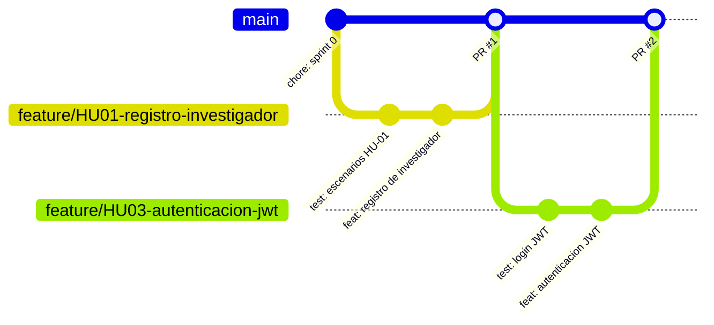

# Asesor CvLAC

Plataforma web de apoyo a investigadores para registrar, organizar y hacer seguimiento a su trayectoria académica e investigativa, y así preparar con orden la información que se registra en CvLAC.

> Proyecto individual. Autor y responsable de todos los roles (Product Owner, Scrum Master y Desarrollador): **Juan David Vidal Muñoz**.

## Declaración de la visión del producto

**Para** investigadores emergentes y consolidados de Colombia **que** tienen dificultades para saber qué información deben presentar en CvLAC y para mantenerla ordenada y trazable,
**Asesor CvLAC** es una plataforma web **que** centraliza su trayectoria investigativa, la organiza por categorías de CvLAC, identifica la información pendiente mediante un checklist y le recuerda sus actividades.
**A diferencia de** llevar la información dispersa en archivos y recordarla al momento de una convocatoria, **nuestro producto** ofrece una guía paso a paso y seguimiento del estado de cada registro (pendiente, preparado o reportado en CvLAC).

> Asesor CvLAC prepara y orienta el registro. No se conecta ni carga datos automáticamente a CvLAC.

## Stack tecnológico

| Capa | Tecnología |
|---|---|
| Lenguaje y framework | Java 17, Spring Boot 3.3 |
| Persistencia | Spring Data JPA, PostgreSQL |
| Seguridad | Spring Security + JWT (Sprint 1) |
| Pruebas | JUnit 5, Mockito, MockMvc, JaCoCo (cobertura mínima 60%) |
| Calidad | Checkstyle (Google Java Style), ISO/IEC 25010 |
| Automatización | Husky (pre-commit), GitHub Actions |
| Frontend | Web (por definir) |

## Arquitectura

MVC por capas: **Controlador** (`controller`, `dto`) → **Servicio** (`service`) → **Repositorio** (`repository`) → **Modelo/Persistencia** (`model`, PostgreSQL). Paquete base: `co.edu.uniajc.asesorcvlac`.

## Estrategia de branching: Trunk-Based Development

`main` es la única rama de larga vida y siempre debe estar en estado desplegable. Todo cambio se desarrolla en una rama corta `feature/*` (idealmente de uno a tres días) y se integra por Pull Request.

**Justificación:**
- El proyecto tiene un único desarrollador, por lo que ramas de larga vida como `develop` o `release` (GitFlow) solo agregarían fricción.
- Integrar con frecuencia reduce los conflictos y mantiene la historia lineal y legible.
- Combinado con CI y Branch Protection, `main` solo recibe código que compila, pasa Checkstyle y cumple la cobertura.
- Ver [ADR-0001](docs/adr/0001-trunk-based-development.md).



**Reglas del flujo**
1. Crear la rama desde `main`: `feature/HU01-registro-investigador`.
2. Commits bajo [Conventional Commits](https://www.conventionalcommits.org/): `feat`, `fix`, `test`, `docs`, `refactor`, `chore`, `ci`.
3. Abrir un Pull Request hacia `main` y completar la checklist de autorrevisión de la plantilla.
4. Fusionar con *squash* o *rebase* solo cuando CI esté en verde y la checklist completa.
5. Eliminar la rama tras fusionar.

## Puesta en marcha local

Requisitos: JDK 17, Maven 3.9+, Node.js 20+ (solo para Husky) y PostgreSQL 15+.

```bash
npm install                      # instala Husky y activa los hooks
mvn verify                       # compila, prueba, Checkstyle y JaCoCo
mvn spring-boot:run              # requiere PostgreSQL con la base asesor_cvlac
```

Variables de entorno opcionales: `DB_URL`, `DB_USER`, `DB_PASSWORD`.

## Documentación

- [Product Backlog](BACKLOG.md)
- [Definition of Done](docs/dod.md)
- [Decisiones arquitectónicas (ADR)](docs/adr/)
- [Guía de configuración del Sprint 0](docs/sprint-0-setup.md)
