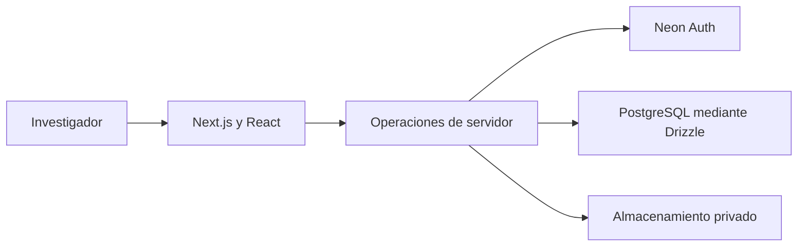
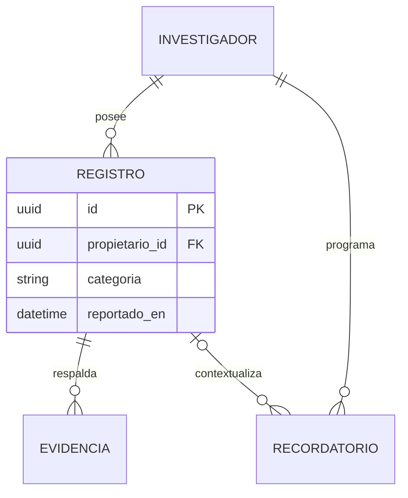
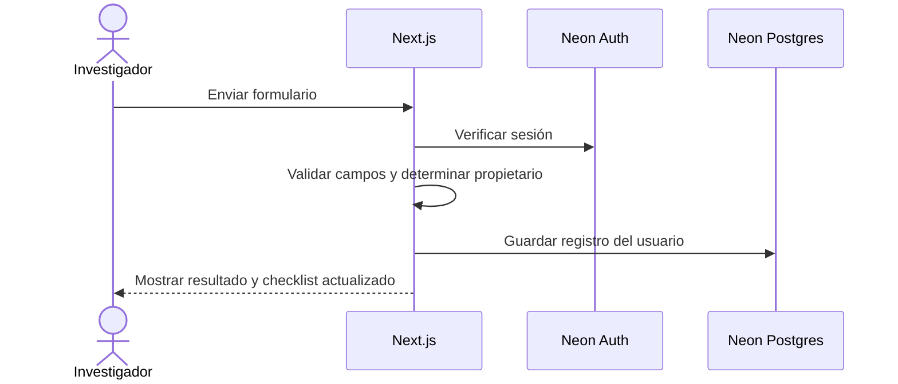

# Arquitectura de Asesor CvLAC

| Pieza | Decisión | Responsabilidad |
|---|---|---|
| Aplicación | Next.js App Router, React, TypeScript | Vistas y operaciones de servidor en un solo proyecto |
| Persistencia | PostgreSQL en Neon y Drizzle | Consultas, restricciones y migraciones SQL versionadas |
| Identidad | Neon Managed Better Auth | Cuentas y sesiones |
| Evidencias | Neon Object Storage privado | Archivos descargables con autorización |
| Checklist | Reglas versionadas en el repositorio | Indicar qué falta según el tipo de registro |

## Estructura prevista

| Ruta | Uso |
|---|---|
| `src/app` | Portada, acceso y rutas del panel |
| `src/features/<modulo>` | Componentes, validaciones y casos de uso del módulo |
| `src/server` | Sesión, base de datos y conexiones con servicios |
| `drizzle` | Migraciones SQL |
| `docs` | Decisiones, operación y plan |

## Modelo inicial

Es un modelo conceptual. Cada categoría define sus propios campos. Las reglas del checklist calculan si un registro está incompleto o preparado. La marca de reportado es explícita y manual. Una contribución puede vincularse a un proyecto del mismo propietario. Una evidencia guarda en PostgreSQL su clave de objeto, tipo, tamaño y relación con el registro.

## Guardar una publicación

Cada consulta, cambio y descarga privada verifica al propietario en el servidor. El identificador del propietario se obtiene de la sesión. Las páginas privadas se sirven sin caché compartida. Los enlaces de archivos son temporales y se emiten después de autorizar el acceso.
