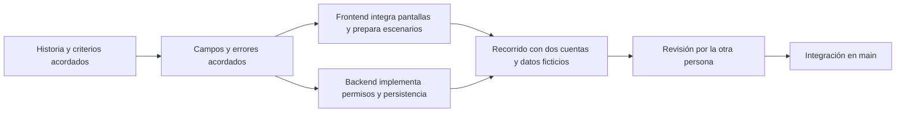

# Plan de trabajo para dos personas

| Persona | Responsabilidad principal | Responsabilidad compartida y adicional |
|---|---|---|
| A · Frontend | Navegación, componentes, formularios, estados de carga, error y vacío | Lidera accesibilidad y aceptación funcional. Prepara datos ficticios, documenta recorridos, integra los formularios con las operaciones de servidor y registra fallos reproducibles. Revisa la experiencia de los PR de backend. |
| B · Backend | Sesiones, consultas, permisos, validaciones de servidor, migraciones y archivos | Mantiene los entornos y la guía operativa. Revisa seguridad, contratos de formularios y tratamiento de errores en los PR de frontend. |

## Entregas

| Orden | Entrega | A · Frontend y aceptación | B · Backend y datos | Resultado observable |
|---|---|---|---|---|
| 0 | Base del proyecto | Portada y estructura | Decisiones y entorno previsto | Equipo puede comenzar desde un repositorio común |
| 1 | Cuenta, perfil y publicaciones | Acceso, perfil, CRUD y primera vista del checklist | Sesiones, esquema y operaciones con permisos | Una persona guarda una publicación, identifica lo pendiente y la marca como reportada |
| 2 | Trayectoria académica | Formularios y listados por categoría | Formación, proyectos, contribuciones y experiencia | El checklist explica los requisitos por categoría |
| 3 | Evidencias y agenda | Subida y descarga, calendario o lista de pendientes | Permisos de archivos, metadatos y recordatorios | Cada persona solo puede consultar sus documentos y pendientes |
| 4 | Piloto | Revisión de teclado, móvil y recorridos con investigadores | Revisión de aislamiento, cuotas y recuperación | Se valida si el flujo ahorra trabajo antes de ampliar el alcance |

## Cómo se trabaja

1. Acordar en la historia campos, acciones, mensajes de error y dueño del cambio.
2. Trabajar en ramas breves desde `main`. Usar un PR por cambio revisable y enlazar la historia.
3. Frontend puede avanzar con datos ficticios mientras backend trabaja en el mismo contrato. Al integrar, retirar los datos simulados del flujo real.
4. La otra persona revisa el PR. Para cerrar la historia, validar los criterios, el acceso con dos cuentas y los estados de formulario relevantes. Actualizar la documentación si cambió una decisión.
